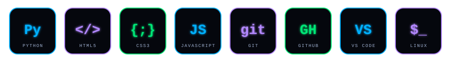

<!-- Header banner -->
<p align="center">
  
</p>

<!-- Typing animation -->
<p align="center">
  <a href="https://github.com/Altaf-byt">
    
  </a>
</p>

<p align="center">
  
  
</p>

<p align="center"></p>

## 🚀 About Me

```python
class Altaf:
    def __init__(self):
        self.name = "Altaf"
        self.github = "Altaf-byt"
        self.role = "Python & Web Development Student"
        self.learned = ["HTML5", "CSS3", "JavaScript", "Python"]
        self.focus = ["Web applications", "Scripting & automation"]
        self.motto = "I love bringing ideas to life with code!"

    def say_hi(self):
        return f"Hi, I'm {self.name} 👋 — let's build something amazing together!"

print(Altaf().say_hi())
```

- 📚 Student of **Python** and **Web Development**
- 💻 Learned **HTML5**, **CSS3**, **JavaScript** and **Python**
- 🛠️ Currently building web applications and scripts
- ⚡ Fun fact: I love bringing ideas to life with code!
- 🔗 My profile: [github.com/Altaf-byt](https://github.com/Altaf-byt)

<p align="center"></p>

## 📈 My Growth Chart

<p align="center">
  
</p>

<p align="center"></p>

## 🧠 My Skills Network

<p align="center">
  
</p>

<p align="center"></p>

## 🛠️ Tech Stack & Tools

<p align="center">
  
</p>

<p align="center"></p>

## 📊 GitHub Stats

<p align="center">
  
</p>

<p align="center">
  
</p>

<!--
  OPTIONAL: animated contribution snake.
  1) Add the workflow file snake.yml at .github/workflows/snake.yml
  2) Run it once: repository > Actions > "Generate Snake" > Run workflow
  3) When it finishes, delete the first line (the opening of this comment) and the last line (its closing) so the image below shows.

## 🐍 Contribution Snake

<p align="center">
  
</p>
-->

<p align="center"></p>

## 🌐 Connect with Me

<p align="center">
  <a href="https://github.com/Altaf-byt" target="_blank"></a>
  &nbsp;
  <a href="https://www.linkedin.com/in/altaf-azimi-912201443" target="_blank"></a>
  &nbsp;
  <a href="https://www.instagram.com/altaf_azimi" target="_blank"></a>
</p>

<p align="center">
  
</p>

<p align="center"><i>⭐ Thanks for visiting — keep coding, keep growing! ⭐</i></p>
