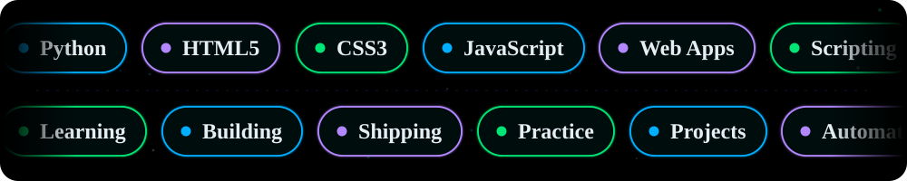

  

  

  
  

  

- Student of **Python** and **Web Development**
- Learned **HTML5**, **CSS3**, **JavaScript** and **Python**
- Currently building web applications and scripts
- Fun fact: I love bringing ideas to life with code!
- My profile: [github.com/Altaf-byt](https://github.com/Altaf-byt)

  

  

  

  

  

  

<!--
  OPTIONAL: animated contribution snake.
  1) The workflow file is already at .github/workflows/snake.yml
  2) Run it once: repository > Actions > "Generate Snake" > Run workflow
  3) When it finishes, delete the first line (the opening of this comment) and the last line (its closing) so the image below shows.

-->

  
  &nbsp;
  
  &nbsp;
  

  

