


  
  

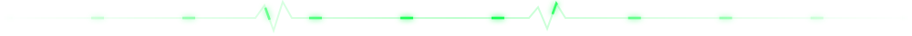



- Student of **Python** and **Web Development**
- Learned **HTML5**, **CSS3**, **JavaScript** and **Python**
- Currently building web applications and scripts
- Fun fact: I love bringing ideas to life with code!
- My profile: [github.com/Altaf-byt](https://github.com/Altaf-byt)










  

  

<!--
  OPTIONAL: animated contribution snake.
  1) Workflow is already at .github/workflows/snake.yml
  2) Repository > Actions > "Generate Snake" > Run workflow
  3) Afterwards delete the first and last line of this comment.

-->


  &nbsp;
  &nbsp;
  


